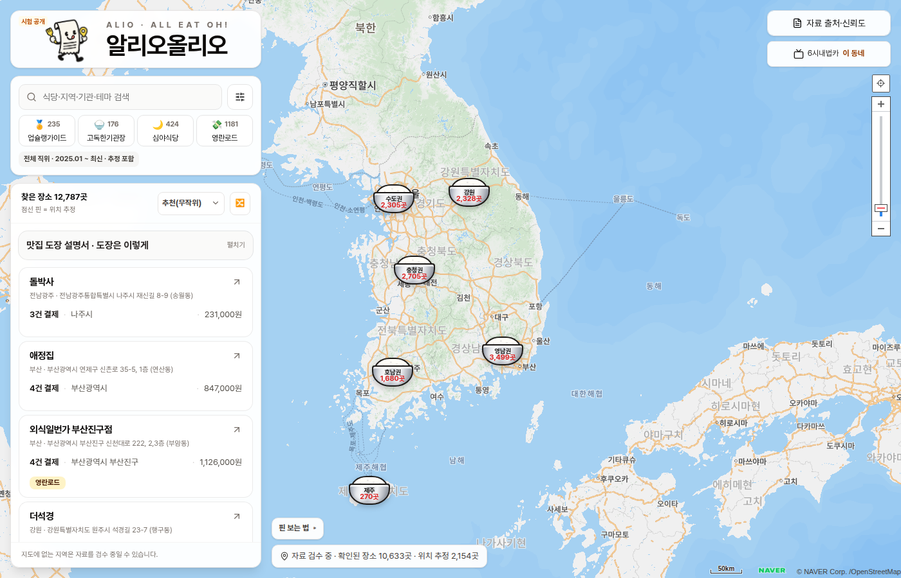
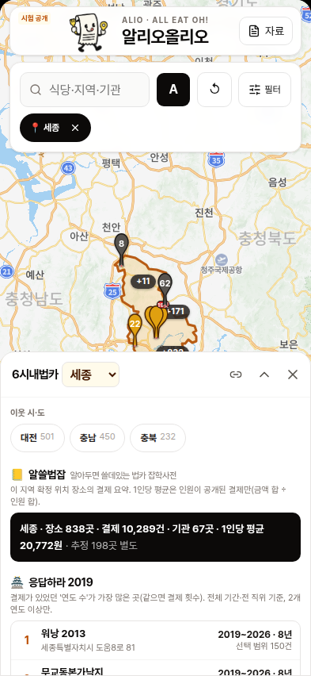

# 알리오올리오 — 공공 부문 업무추진비 맛지도

> 공공기관·지방정부·중앙부처·지방공기업이 공개한 **업무추진비 결제 기록**을 식당 지도로 모았습니다.
>
> 어느 식당을 여러 기관이 오래 찾았는지, 지역·기관·연도별로 지도와 목록에서 확인합니다.
>
> 공공데이터 기반 · 로그인 없음 · 무료 · 시험 공개(베타)

| | |
|---|---|
| 🌐 **사이트** | https://alioolio.k-union.kr |
| 📱 **이용 환경** | PC·모바일 웹 브라우저 (국내 접속) |
| 🔄 **갱신 주기** | 분기 또는 반기 |
| 🏷 **분야** | 공공행정 · 공공데이터 · 지도 서비스 |

---

## 🍽 어떤 서비스인가요

공공기관은 업무추진비를 어디에서, 언제, 얼마나 썼는지 공개합니다. 다만 기관마다 게시판·파일 형식이 달라 한눈에 보기 어렵습니다.
알리오올리오는 이 공개 자료를 모아 **결제 장소를 실제 식당 위치와 맞춰 지도에 올린 서비스**입니다.

- 우리 동네에서 여러 기관이 오래 찾은 식당은 어디인지
- 기관별로 그해 가장 많이 결제한 곳은 어디인지
- 지역별로 결제 규모와 단골 식당은 어떤지

를 지도와 목록으로 살펴볼 수 있습니다.

| PC | 모바일 |
|---|---|
|  |  |

## 📚 수록 범위 (2026-11-11 기준)

| 항목 | 규모 |
|---|---|
| 지도에 오른 장소 | 27,406곳 |
| 지도에 연결된 결제 기록 | 215,704건 (원본 대조 확인 211,061건) |
| 장소가 1곳 이상인 기관 | 244개 |
| 기간 | 2019년 ~ 최신 공개분 |

자료는 **분기 또는 반기마다** 새 공개분을 모아 갱신합니다.

## 🧭 주요 기능

- **지도·목록 검색**: 식당·지역·기관 이름으로 검색하고, 기관 유형·직위·기간으로 좁혀 봅니다. 멀리서는 권역별 고봉밥 묶음, 가까이 갈수록 결제가 많은 곳부터 핀이 드러납니다.
- **맛집 도장(테마)** — 여러 개를 켜면 겹치는 곳만 보입니다.

  | | 도장 | 기준(요약) |
  |---|---|---|
  |  | 🏅 **업슐랭 가이드** | 광역 시·도마다 여러 기관이 여러 해 찾은 식당 상위 20곳(3개 기관·4개 연도·10건, 자료가 적은 지역은 최소 2곳) + 카페 최대 3곳 |
  |  | 🍚 **고독한 기관장** | 기관장이 1~2인으로 결제한 기록이 2건 이상 |
  |  | 🌙 **심야식당** | 기관장 결제 중 밤 8시~새벽 5시 결제가 3건 이상 |
  |  | 💸 **영란로드** | 1인당 식사 가액 기준(3만 원, 2024.8.27부터 5만 원)의 90~100% 결제 3건 이상 또는 건당 50만 원 이상 2건 이상 (참고 지표) |

- **연도별 금·은·동수저 · 장기집권**: 같은 기관이 그해 4건·3개월 이상 결제한 곳을 단골로 보고, 결제 횟수 1~3위에 🥇🥈🥉 금·은·동수저, 3년 연속 1위면 장기집권 👑.
- **검색으로 거르기**: 식당·지역·기관 이름 외에 '업슐랭', '심야식당', '금수저', '단골', '장기집권' 같은 테마·수저 이름으로 검색하면 그런 곳만 보입니다.
- **직위 필터**: 전체 직위(기본) · 기관장 · 임원 · 본부장 · 부서장 · 기타 직위.
- **📺 6시내법카(지역 리포트)**: 시·도/시·군·구를 고르면 지역에 음영을 씌우고 결제 요약, 오래 사랑받은 곳, 최근 줄 서는 곳 등을 보여 줍니다.
- **🤖 AI 메뉴 찾기**: "세종에서 국밥"처럼 물으면 AI가 지역·메뉴를 알아듣고 네이버 지역 검색 후보와 수록 식당을 대조해 보여 줍니다(메뉴·맛·영업은 보증하지 않음).
- **내 위치 · 네이버 지도 연결**: 내 주변 식당을 보고, 식당 카드에서 네이버 지도 장소 정보로 바로 넘어갑니다.

## 🛠 자료와 방법

- **결제 기록**: 각 기관이 공개한 업무추진비 사용 내역 — ALIO(공공기관 경영정보 공개시스템), 기관 홈페이지 공개 게시판(공공기관·지방정부·중앙부처·지방공기업).
- **장소 매칭**: 결제처 상호를 식품 일반음식점 인허가 자료(공공데이터포털)와 대조해 위치를 정했습니다. 원문과 상호·주소가 하나로 확인되면 **확정**, 후보가 하나뿐이지만 일부 확인이 남으면 **위치 추정**(지도에서 점선 핀)으로 표시합니다.
- 지역 경계·지도 출처는 아래 데이터 출처를 보세요.

## ⚠️ 알아 두세요

- 공개된 **과거 결제 기록**을 정리한 것입니다. 직위는 결제마다 공시된 값이며 **본인 참석이나 현재 방문을 뜻하지 않습니다.**
- 도장·수저는 재미로 붙인 분류입니다. **맛 평가나 적법·부당 여부 판단이 아닙니다.**
- 개인 이름, 연락처, 카드번호, 원본 파일은 싣지 않습니다.
- 위치 추정 장소는 실제 결제 지점과 다를 수 있습니다. 잘못된 위치·상호는 사이트의 정정 요청으로 알려 주시면 고칩니다.

- 원문 공개 시점과 갱신 주기에 따라 최신 결제가 늦게 반영될 수 있습니다.
- 소스 코드는 공개하지 않습니다.

## 🗂 데이터 출처
- 업무추진비 사용 내역: [ALIO 공공기관 경영정보 공개시스템](https://www.alio.go.kr)(공시 검색은 [ALIO-RAG](https://gitlab.aigov.go.kr/bigone-kised/alio-rag) 활용), 각 기관 홈페이지 공개 게시판
- 음식점 위치: [공공데이터포털 식품 일반음식점 인허가 정보](https://www.data.go.kr)
- 지역 경계: 통계청 SGIS 행정동 경계(공공누리 제1유형), [vuski/admdongkor](https://github.com/vuski/admdongkor)(CC BY 4.0)
- 지도: NAVER 지도, © OpenStreetMap contributors

## 🔗 관련 프로젝트
- [ALIO-RAG](https://gitlab.aigov.go.kr/bigone-kised/alio-rag) — 공공기관 ALIO 공시 문서와 근거 법령을 AI 도구에서 조항 단위로 검색하는 MCP 서버입니다. 알리오올리오의 공공기관 업무추진비 공시는 ALIO-RAG로 찾아 모았습니다.

## 📮 문의
bigone@k-union.kr
